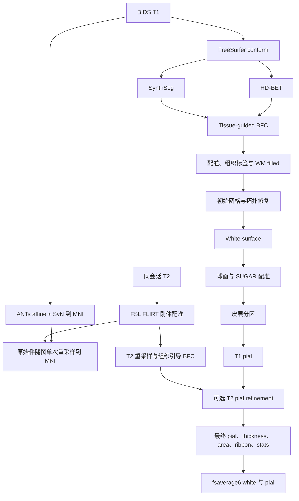

# FastPrep Anat

独立的结构 MRI 皮层重建项目，输入为 BIDS T1w，可选同一被试、同一会话的 T2w。包内包含流程代码、模型源码与必要权重、QC 工具和环境配方，无需 BrainBoot 或 LangGraph。

本版默认采用 GPU RBF 的可靠组织核心偏置场矫正，保留 Gaussian CPU 显式备选，两者封装为 `bin/tissue_bfc/` 工具包。亮斑原因、方法修订、独立使用及验证限制见 [docs/BIAS_CORRECTION.md](docs/BIAS_CORRECTION.md)。切换默认不是科学 QC 批准。T2 可用于 FreeSurfer pial surface refinement；保留 T1 初始 pial，最终 pial 用于厚度、面积、ribbon、分区统计和 fsaverage6 输出。

`anat_motioncor` 按 [sMRIPrep 的 FOV 判断](https://github.com/nipreps/smriprep/blob/master/src/smriprep/workflows/surfaces.py)检查转换后 MGZ 的 `shape × voxel_size`。任何方向超过 256 mm 时，自动为 `recon-all -motioncor` 添加 `-cw256`；其余输入沿用原命令。该选项让 FreeSurfer 生成 256³、1 mm 网格，可能裁剪外围覆盖，不是关闭 FOV 检查，也不是 `robustfov`。阶段 `conform_fov.json` 和 manifest 指标记录输入/输出几何、参数与体素坐标映射；脑组织覆盖仍需结合原图和既有 QC 审核。局部恢复可通过 `--motioncor_helpers /path/to/revision/bin` 只替换此节点的实现。

已去除项目自行设置的文件哈希、源码锁和运行时哈希锁。保留文件存在性、会话身份、物理网格、有限值、标签和表面顶点对应检查；Nextflow 使用自身正常缓存支持 `-resume`。

本版对应 FreeSurfer 8.1.0 集群部署。默认 `report_only` 会记录自交、翻折和其他质量告警。真实产物满足下游读取和对应关系要求时继续计算，最终报告保留 `fail` 或 `unknown` 判定。[三节点运行与 GPU 重建说明](docs/CLUSTER81.md)

Git 仓库通过 Git LFS 保存模型权重。首次克隆前运行 `git lfs install`；已有工作副本运行 `git lfs pull` 获取权重。本机的 `software.local.json`、`.site/` 和受试者运行数据留在各自的机器上。

## 1. 目标机器准备

支持 Linux。需要自行安装以下软件，压缩包不包含它们：

- 默认 GPU 表面后端需要 FreeSurfer 8.1.0 Ubuntu 20（`f30dfed`）的匹配构建和兼容 NVIDIA CUDA 的 GPU（见 `vendor/topology/README.md`、`vendor/t2_pial/`）。7.3.2 是原生 CPU 接口参考版本，不是 GPU 构建的替代。还需要完整的 `fsaverage6`、GCA/GCS 模板和用户自己的有效 license。
- FreeSurfer 所需系统依赖，尤其是 `/bin/tcsh`（`recon-all`、`talairach_avi` 等脚本的解释器）；Debian/Ubuntu 通常通过 `sudo apt install tcsh bc` 安装。
- FSL FLIRT（`$FSLDIR/bin/flirt`），用于同会话结构像的刚性配准和重采样。
- FireANTs 1.5.0 和 CUDA PyTorch，用于默认的 MNI 仿射与非线性配准。ANTs 的 `antsApplyTransforms` 用于输出重采样；显式选择 `--mni-backend ants` 时还需要 `antsRegistration`。ANTs 路径通过 `ants_bin`、`ANTSPATH` 或 `PATH` 指定；模板来自可读的 TemplateFlow 缓存。
- Java 17–25、Nextflow ≥25.10（8.1 集群验证版本 25.10.4）。
- Conda/Mamba 或已有的相应 Python 环境。完整模型包约 1.38 GB；实际被试运行空间明显大于源码包。建议至少 32 GB RAM，根据并发数增加。

七个 Python 配置分别隔离控制/Gaussian、GPU BFC、SynthSeg、SUGAR、HD-BET、QC 渲染和几何计算；也可指定已有的兼容解释器，不必创建七份独立环境。安装配方和已观测版本见 [docs/DEPENDENCIES.md](docs/DEPENDENCIES.md)。这些配方没有在全新机器上安装验证；PyTorch CUDA 构建以及 SUGAR 的 torch-scatter、PyTorch3D 必须与目标 GPU/驱动匹配。

在项目根目录创建环境，例如：

```bash
conda env create -p "$PWD/envs/helper" -f envs/helper.yml
conda env create -p "$PWD/envs/bfc" -f envs/bfc.yml
conda env create -p "$PWD/envs/synthseg" -f envs/synthseg.yml
conda env create -p "$PWD/envs/sugar" -f envs/sugar.yml
conda env create -p "$PWD/envs/hdbet" -f envs/hdbet.yml
conda env create -p "$PWD/envs/qc" -f envs/qc.yml
conda env create -p "$PWD/envs/geometry" -f envs/geometry.yml
```

也可以在配置中填写已有解释器的绝对路径，不必重复创建环境。

```bash
export FREESURFER_HOME=/opt/freesurfer/8.1.0
source "$FREESURFER_HOME/SetUpFreeSurfer.sh"
export FSLDIR=/opt/fsl
cp conf/software.example.json software.local.json
```

编辑 `software.local.json`，检查工具路径和 `python` 下七个解释器，特别是新增的 `python.bfc` 必须支持 CUDA PyTorch。若 license 不在 FreeSurfer 安装目录，可增加 `"fs_license": "/path/to/your/license.txt"`。配置只引用 license 路径，不打包其内容。

## 2. 输入与配置

默认体积模板为 **`tpl-MNI152NLin2009cAsym`、`res-01`（1 mm）**。在能联网的机器上预取 T1w 和同网格脑掩膜，保留模板目录的 `LICENSE` 和 `template_description.json`。下载客户端可单独安装，不必改变重建环境：

```bash
python -m venv /path/to/templateflow-client
/path/to/templateflow-client/bin/python -m pip install templateflow
export TEMPLATEFLOW_HOME=/path/to/templateflow-cache
/path/to/templateflow-client/bin/python bin/mni_template.py
```

`bin/prepare.py` 默认读取 `TEMPLATEFLOW_HOME`（未设时为 `~/.cache/templateflow`），完整读取影像并核对 mask，不会在计算节点下载。可为预取和准备两个命令传相同的 `--mni-template tpl-MNI152NLin2009cAsym --mni-resolution 1 --templateflow-home /path/to/cache`。`--mni-resolution` 是 TemplateFlow 的分辨率编号，不是对原图重采样的任意间距。

### MNI 体积输出

每个会话使用**与皮层重建相同的原始 T1w**，以模板 T1w 为固定图，默认用 **FireANTs 在所选 CUDA 设备上估计 affine 和 Greedy 非线性配准**。`prepare.py --mni-backend fireants` 为默认值；`--mni-backend ants` 显式保留原来的 ANTs affine + SyN。FireANTs Greedy 与 ANTs SyN 是不同算法，不宣称结果等价。皮层重建仍在原有空间完成，不使用扭曲后的 MNI 影像建面。

FireANTs 由 `python.bfc` 启动，已加入该环境的依赖配方；也可在软件配置的 `python` 中添加可选的 `"fireants": "/path/to/fireants/bin/python"` 指定独立环境。已有 BFC 环境需安装 `fireants==1.5.0`，重新运行 prepare 的环境检查。计算设备沿用 Nextflow 的 `--device cuda:0`；CUDA 不可用、内存不足或请求 CPU 时明确失败，不静默切回 CPU。全流程 CPU 方案需同时在 prepare 时选择 `--mni-backend ants --bfc-method gaussian`，再使用文中的 CPU 表面参数。

FireANTs 使用强度重心初始化、MI affine、模板脑掩膜内的局部 CC Greedy compositive 形变；尺度为 8/4/2/1，affine 迭代上限为 200/100/50/20，非线性为 100/70/50/20，支持提前收敛。Greedy 在 GPU 上仿射重采样的拟合图上估计形变，再将 affine 与形变复合；最终输出仍从原始影像一次取样。正向位移场是 ITK LPS 毫米下从模板到原始 T1w 的完整取样映射，**已经包含 affine**；独立 affine 仅用于来源追踪。逆场在原始 T1w 网格上用 GPU 数值求逆，检查内部点的正逆闭合残差，未收敛则报错。Jacobian 在物理 LPS 轴下计算，保留 `T1wToTemplateJacobian.nii.gz`；脑掩膜内非正值或非有限值会阻断输出。全部参数、实际设备、版本、分阶段耗时、Jacobian 统计和逆场检查写入 `T1wToTemplatefireants.json`。

同会话其余 T1w/T2w/FLAIR 复用各自到原始 T1w 的 6-DOF FLIRT 矩阵，转换为 ITK LPS 取样变换。FireANTs 后端以 `-t full_warp -t rigid` 对**原始伴随影像**调用一次 `antsApplyTransforms`，原始 T1w 仅使用 `-t full_warp`；禁止重复应用 affine。ANTs 后端保留 `-t warp -t affine -t rigid`。用于刚性配准 QC 的中间图不作为 MNI 输入。该分支只处理连续强度，不以线性插值处理标签或 mask。

MNI 节点在读取模板、T1w 和伴随影像之前统一 NIfTI 空间选择：优先使用能由 qform 准确表示的有效 sform；sform 含不可表示的剪切时使用有效的编码 qform；两者均未编码时明确使用 NiBabel 的居中 LAS 默认坐标。只有剪切 sform 而无编码 qform、编码坐标左右手性冲突或非毫米单位会明确报错。MNI 工作副本的 qform/sform 同时设为选定坐标，并验证 NiBabel 与 ITK 读取结果一致；原始文件、体素顺序、存储值及强度缩放均保留。准备副本不插值，最终 MNI 强度输出仍只插值一次。伴随影像的 FLIRT 矩阵先按原始 FSL 体素坐标解释，再转换到选定的物理坐标。

`mni/geometry.json` 记录原始编码、选定形式、工作副本、坐标差异和不确定性；`manifest.json` 声明所选原生网格。逆场及 ITK 变换对应这些明确空间的工作副本，后续使用时须配对 `mni/geometry/` 内相应影像，不能重新让读取库从有歧义的原始头信息选择坐标。缺失编码或两种编码不一致仍需解剖方向审核，运行成功不代表科学 QC 通过。选择性续跑可用 `--mni_helpers /path/to/revision/bin`；该 MNI 节点同时绑定该目录的 FireANTs 脚本，避免旧 runtime 再调用旧实现。

发布在 `outdir/<分析单元>/mni/`：包含每个原始序列的模板空间 NIfTI、affine、正逆形变、转换后的刚性矩阵和 `manifest.json`。其中记录后端、配准与重采样耗时、模板标识、分辨率、物理网格、源图及每个输出的 ANTs 变换列表；`outputs.json` 通过 `mni_manifest` 索引。通过有限值/网格/数值闭合检查不代表解剖配准合格，仍需三视图叠加检查脑缘、脑室、局部形变（特别是病灶），以及用途所需的 Jacobian/折叠检查。从旧版本升级须重新 prepare、新建 work/out；没有后端字段的旧 blueprint 保持原来的 ANTs 行为，已启动的旧流程不会自动切换。

最小输入示例：

```text
bids/
  dataset_description.json     # 包含 BIDSVersion
  sub-01/anat/sub-01_T1w.nii.gz
  sub-01/anat/sub-01_T2w.nii.gz # 可选
  sub-02/ses-01/anat/sub-02_ses-01_T1w.nii.gz
```

每个会话选择一个 T1 做重建；启用 T2 精修时，独立选择同一会话的一张 T2。`bin/prepare.py --selection-policy resolution-snr`（默认）在同模态有多个候选时，先选体素体积较小者，同体积时优先最大轴间距较小者，再选信噪比代理值较高者。体积和间距取自 NIfTI 仿射，分别保留到 0.0001 mm³ 和 0.0001 mm；这是图像网格分辨率，不是对原始采集分辨率的测量。自动选择只考虑未标 `part` 或 `part-mag` 的图像。未选的 run 仍留在同会话配准列表，不做平均。

信噪比代理值是同一模态内的相对排序指标：均匀抽样不重叠的 2×2×2 体素块，排除含非正值的块；用块均值第 95 百分位的 20%–100% 作为前景范围，用前景块均值的中位数除以三维 Haar 高频系数的稳健噪声估计（MAD / 0.67449）。少于 64 个可用块或无法估计噪声时记为 `null`，不会因零噪声给无限分；分辨率相同时有估计值者优先，仍并列则按 BIDS `series_id` 稳定选择。评分不检查全脑覆盖、运动、过度平滑或插值放大，不能代替输入 QC；不同视野、局部高分辨扫描或重建协议混杂时应显式指定。`inputs.json` 的 `selection` 记录每个模态的决策及自动排名，最终 `t1w_manifest.json` 也保留该记录。

`--selections selections.tsv` 的手工指定始终优先于排名，可以只填 T1 或 T2。TSV 列名为 `subject session t1w t2w`，使用制表符分隔；无会话时 `session` 留空，图像路径可相对 BIDS 根目录。可从 [conf/selections.example.tsv](conf/selections.example.tsv) 开始。需要保留“多候选未指定就报错”的行为，可传 `--selection-policy strict`。

同一会话其余结构像均用 FSL FLIRT 配准到选定的原始 T1w，仅估计 6 个刚性自由度；粗搜索和优化都用 `mutualinfo`（32 bins），输出用三线性插值。QC 的配准前基线只按图像头的物理坐标重采样，不估计运动。选中用于 pial 的 T2w 从原始图像直接插值到重建网格：先组合 T2w→原始 T1w 矩阵与原始 T1w→重建网格的头信息映射，不会重复插值。旧 ANTs `.mat` 与 FLIRT `.mat` 不可互换；改用 `fsl_dir`（或导出 `FSLDIR`），重新 prepare 到新目录，不要复用旧配准结果。

```bash
envs/helper/bin/python -B bin/prepare.py \
  --bids-dir /data/bids \
  --software software.local.json \
  --output /data/fastprep-control \
  --subjects sub-01 \
  --t2-mode auto
```

可选参数：`--sessions ses-01`、`--selections selections.tsv`、`--bfc-method rbf|gaussian`（默认 RBF，同时配置 T1/T2）；多个被试/会话用逗号分隔。准备程序检查原始图像的维度、有限值、非空和空间信息，并探测各解释器及原生工具。它不等同于完整 BIDS Validator 或图像质量审核。

T2 模式：

| 模式 | 行为 |
| --- | --- |
| `auto`（默认） | 有同会话 T2 时按选择策略优化 pial，无 T2 时使用 T1 pial |
| `require` | 每个选中会话必须有明确的 T2 |
| `off` | 不使用 T2 优化 pial |

输入应为覆盖完整头部、适合成人皮层重建的 T1/T2。高分辨率与结构检查通过不保证解剖质量；运动、局部缺失、病灶及配准仍需 QC。新生儿数据不属于当前模型的已验证适用范围。

## 3. 运行

```bash
nextflow run main.nf \
  --runtime /data/fastprep-control/runtime.json \
  --blueprint /data/fastprep-control/workflow.json \
  --helper_python "$PWD/envs/helper/bin/python" \
  --threads 4 --device cuda:0 \
  --qc_mode report_only \
  --outdir /data/fastprep-results \
  -work-dir /data/fastprep-work
```

默认设备为 `cuda:0`，也可用 `--device cuda` 或可见设备编号。FireANTs、RBF、SynthSeg 神经网络推理、HD-BET 和 SUGAR 使用所选设备；SynthSeg 的图像预处理和后处理仍在 CPU 完成。FireANTs 和 RBF 禁止静默 CPU 回退；要使用 CPU，请先显式选择 `--mni-backend ants --bfc-method gaussian` 重新准备配置，再在 Nextflow 运行时传 `--device cpu --t1_placement_backend cpu --t2_pial_backend cpu --topology_backend cpu`。GPU 模式将 SynthSeg 原有的左右翻转集成分两次推理执行，再在主机内存中恢复空间/标签顺序并取平均，以降低峰值显存；不裁剪图像、不改变权重、平滑或集成算法。显式请求 GPU 时，SynthSeg 会验证 GPU 卷积及模型权重所在设备，不会静默回退到 CPU，并在阶段 provenance 中记录实际设备和集成执行方式。TensorFlow 必须能加载匹配的 CUDA/cuDNN 库。SLURM 可加 `-profile slurm`，通过 `-c cluster.config` 提供队列、内存和 GPU 资源请求；选择 CUDA 不会自动向调度器申请 GPU。所有计算节点须能访问相同的项目、输入和环境路径。

SynthSeg 推理与标准后处理在同一进程内传递概率数组，流水线只保存分割标签、小型体积统计和运行记录，不生成 `raw.npy` 或 `cleaned.nii.gz` 概率文件。模型、左右翻转集成、拓扑后处理和标签空间检查均保留；运行记录分别计时模型加载、推理与合并、后处理和输出保存。

计算节点默认申请 8 个 CPU 线程（`--threads 8`），普通左右半球任务各分配 4 线程；GPU white/pial placement 保留每侧最多 2 个主机线程。QC 默认申请 8 线程（`--qc_threads 8`），在同一 QC 组内并行生成不同上游阶段的证据，每个子任务的底层线程上限为 1，并按原顺序合并报告。`report_only` 下，主计算直接读取已完成的科学节点，与报告型 QC 并行；最终发布仍等待全部 11 组 QC，保留所有失败、未知与证据。`strict` 保留原有 QC 阻断顺序。分割指标先定位每个标签的完整包围盒，再计算连通分量、孔洞和体积；边界比例仍以原始全图边界计算，保留所有标签、体素和原有指标定义。

默认 `report_only` 继续计算并保留失败、未知和待目视复核的结果，**不会自动批准科学结果**。`strict` 会在未通过 QC 时停止，默认未审阅的策略与视觉证据也会阻断。见 [docs/QC.md](docs/QC.md)。

独立的左右半球处理默认并行，包括网格化、拓扑修复、去自交、灰白质强度估计、white/pial placement、cortex 标签、平滑/膨胀、曲率统计、球面生成及 SUGAR 配准、Jacobian、皮层分区、灰白质对比度、分区统计、球面对应检查和 fsaverage6 表面重采样。同一半球内保持原有先后顺序。普通节点平分任务 CPU 配额；white/pial placement 在 4 核任务中每侧 2 线程，并支持 GPU 后端。每侧日志及检查结果独立保存，任一侧失败都会阻止该阶段完成。节点参数 `hemisphere_workers=1` 可选择串行执行；GPU 阶段还可用 `gpu_hemisphere_workers=1` 限制同一设备上的半球任务数。

`anat_ribbon` 在分配至少四个 CPU 时默认启用原生 `mris_volmask --parallel`，只生成 ribbon。独立的 `anat_cortical_pair` 节点读取已完成的 ribbon，以两个独立进程测量左右 white/pial，按任务核数分配线程预算；一个 CPU 时测量串行运行。完整顶点、三角面相交、厚度和覆盖检查均保留，测量结果进入 pial/ribbon QC 及最终报告。报告模式下，后续体积和统计计算可与成对测量并行。分别在 ribbon 和成对测量节点设置 `ribbon_parallel=false`、`metrics_parallel=false` 可运行串行对照。已有批次需在被试边界更新流程并重新 prepare；不能在活动任务中混用旧的 50 节点 blueprint。计时字段及解释见 [docs/QC.md](docs/QC.md)。

拓扑节点默认 `--topology_backend gpu`：仅快速球面化的距离、面积和法向重算使用 CUDA；步长决策、遗传修复及去自交仍用 FreeSurfer CPU。每半球记录实际 GPU 调用数、设备和耗时，不兼容即报错；可显式选 `--topology_backend cpu`。构建与 ABI 见 `vendor/topology/README.md`。

表面放置的 `nsmooth` 按 FreeSurfer 8.2.0（`d932c45`）`scripts/recon-all` 的非纵向流程设置：`anat_white_surface.parameters.nsmooth=5`，对应从 `orig` 到 `white.preaparc` 的初始化；`anat_pial_surface.parameters.nsmooth=0`，用于 T1 pial 和可选 T2 pial 放置。这不是将所有阶段统一平滑 5 次，也不是单独运行 `mris_place_surface` 时未传参数的程序默认值。运行时按配置传递给 CPU/GPU 后端并逐半球记录，显式覆盖必须为非负整数；缺少字段时按上述阶段默认值处理。旧配置中显式的 `0` 仍作为覆盖保留，采用新默认需重新准备配置。FastPrep 仍将检查通过的 `white.preaparc` 原样复制为 `white`，本次不新增分区后的第二次 white 放置，也不更改拓扑修复的 `-s`。官方默认参数不保证每个个体自交最少或为零；后置自交硬检查与解剖 QC 均保留。

初始拓扑修复可通过 `anat_fix_topology.parameters.topology_smoothing_iterations` 显式设置 FreeSurfer `mris_fix_topology -s`，只对重新三角化的顶点执行原生 soap-bubble 平滑；默认 `0` 保持既有行为。该参数必须是非负整数，实际值写入逐半球 provenance。拓扑已修复但去自交停滞时，可在独立修复尝试中评估此参数，再重跑受影响的下游；它不是全表面平滑，也不是 QC 容差。初始化要求 Euler=2、零拓扑缺陷、零自交、有限坐标与顶点/面对应；white/pial 放置之后再次执行零自交硬检查，最终解剖仍需原标准复核。

tessellation 前按官方 recon-all 的第二次 pretess 顺序，对左右半球分别执行 `mri_pretess filled.mgz 255/127 norm.mgz`，各自从原始 filled 生成独立的 `{hemi}.filled.pretess.mgz`。保留原始 filled；记录每种标签转移，核对几何、有限性和标签语义。网格化消费对应半球的新文件，初始化 QC 按现有 `SEG.TISSUE` 硬标签规则直接显示该实际输入的半球前景，保持待目视复核状态。

**默认报告模式**在拓扑修正后保留原生 GA 候选，运行去自交和有界局部修复，并记录实测值。white/pial 放置后仍有自交时记录并继续。超出球面修复范围时保留有对应关系的有限坐标。每个 session 的 `outputs.json` 在 `quality_warnings` 中汇总告警。

**严格模式的几何门控与恢复**如下。执行原生 `mris_remove_intersection`，并独立测量保存结果。`orig`/`orig.premesh` 必须在进入 white 前达到零自交；未清除的残留会使初始化失败，不发布 `orig.premesh` 副本。新初始化记录标注 `self_intersection_gate=initialization`、`self_intersection_status=measured`。每半球的 white、T1 pial 和可选 T2 pial 放置返回后，再对实际写出的网格运行 `mris_euler_number` 和 `mris_info --intersections`，要求 Euler=2、零缺陷、零自交；缺失或歧义测量也失败。只有检查通过才复制最终表面或计算曲率、面积、厚度。CPU/GPU 共用此门槛，并保留输入不变、有限坐标、顶点/面对应及参考体积几何检查。初始化 QC 不再接受延后自交判定的标记。已有批次的冻结快照和失败记录保持原状；采用此变更需以新代码和配置重新准备，并重算受影响的下游。

对原生去自交停滞的初始化网格，当前 blueprint 在拓扑候选预演和最终去自交节点启用 `local_fairing_recovery=true`。按 2、3、5 环依次尝试有限邻域，固定区域外顶点，求解均匀调和坐标并整体缩放，使初始扰动不超过 1 mm；必要时再运行原生去自交。每个候选均从原生停滞结果重新开始，最多涉及 1000 顶点，最终相对该结果的最大位移不得超过 `local_recovery_max_displacement_mm=2.5`，区域外坐标必须不变。这个上限限制算法移动量，不是解剖 QC 合格阈值。 恢复文件只替换原生三角网格的坐标字节，逐字节保留面连接及体积几何 footer，避免通用写入器截短 CRAS 精度；几何检查仍要求逐值一致。必须通过 Euler=2、零缺陷、零自交、非退化三角面、有限坐标、逐索引面连接及参考体积几何检查；所有候选及失败证据保留。它只恢复初始化，不修改 FreeSurfer 官方二进制，也不批准最终 white/pial 解剖结果。全部候选失败仍停止；须复核局部形状并重新计算受影响下游。

独立原生拓扑修复重试还可显式设置 `anat_fix_topology.parameters.topology_repair_seed`，仅改变 `mris_fix_topology -ga -seed`，不改变原始初始化和平滑/快速球面的 `topology_seed`。默认沿用 `topology_seed`，新值必须是非负整数，实际值写入逐半球 provenance；这仍是需要重新计算受影响下游并通过原门槛的算法尝试，不是旧缓存的原样重用。

拓扑节点默认配置一个有限恢复尝试：`topology_recovery_attempts=[{"seed":4321,"smoothing_iterations":10}]`。节点先对原参数生成的候选预演原生去自交；预演达到零自交时保持原候选，残留非零时先尝试上述有界局部恢复；恢复耗尽才用这组参数重新搜索和修复拓扑，复用同一份初始网格与快速球面。每次候选和清理输出使用独立路径，保留真实计数与命令；只选择原生清理或有界恢复后零自交且拓扑、有限坐标与面对应均通过的候选，全部尝试失败则停止。后续去自交节点仍重新执行并独立验收，white/pial 后的检查也保留。列表可显式设为空以关闭恢复；每项必须包含非负整数 `seed` 和 `smoothing_iterations`。恢复会改变顶点或连接，必须重新计算下游，不能沿用旧 pial 或顶点属性。这是有限恢复策略，不保证所有被试自动成功，也不替代解剖 QC。

正常续跑使用相同命令加 `-resume`。改变输入、配置或算法后使用新的 control、work 和结果目录；外部模型与环境变化不依赖额外内容锁自动检测。跨机器解压后重新运行 `prepare.py`，不要复制旧机器生成的绝对路径 runtime 配置。

## 4. 流程与输出

完整定义在 [conf/workflow.json](conf/workflow.json)：51 个节点、250 条连接、19 类发布输出；其中 40 个计算节点（含独立成对测量）与 11 个 QC 节点。科学依赖边直接绑定产物源，`qc_gate` 标记严格模式需要等待的 QC；模式切换及最终 QC 汇合由 `main.nf` 执行。

T2 pial refinement 使用同会话 T2 配准后的偏置场校正、WM=110 标定结果，并保留重建视野内的完整头部，不再按 T1 脑掩膜裁切。传入 `--mmvol` 的 `T2.mgz` 与 `T2.norm.mgz` 逐字节相同；脑域校正与脑外信号保留的区别见 [docs/BIAS_CORRECTION.md](docs/BIAS_CORRECTION.md)。

T1 pial 初始化已恢复原生默认：`anat_pial_surface.parameters.t2_initial_t1_threshold_scale=1.0`，有无 T2 都不额外降低 T1 边界阈值。仅在显式设置小于 1 的实验系数且 T2 已成功准备时，才将自动检测的 `pial_border_low`、`pial_border_hi`、`pial_outside_hi` 乘以该系数；不手动膨胀网格。系数须在 `(0, 1]` 内且保持阈值顺序，旧配置缺少此参数时也不调整。无 T2 或 `t2_mode=off` 的 T1-only 命令保持原配置；T2 refinement 不继承初始 T1 的覆盖参数。逐半球实际设置写入 refinement manifest 的 `initial_t1_pial`。历史 0.85/0.90 实验保留但不再作为默认；所有候选仍按原标准检查组织边界、嵌套、自交、厚度和 ribbon。

T2 refinement 正式采用用户选定的 `l060_c080_n060`：`anat_pial_surface.parameters.t2_refinement_overrides={"location": 0.6, "curv": 0.8, "nspring": 0.6}`。仅在 T2 refinement 的 `--mmvol IMAGE T2` 之后追加 `--location 0.6 --curv 0.8 --nspring 0.6`；不传入初始 T1 placement 或 T1-only 命令。T2 强度限制保留原生 110/300/130/300；该接口也支持显式设置 `mm_min_inside`、`mm_max_inside`、`mm_min_outside`、`mm_max_outside`。旧配置缺少此字典或显式设为空时保留原生命令。参数须有限、为正、阈值有序，`nspring` 不得超过原生上限 1，实际配置写入 manifest 的 `t2_refinement_parameters`。参数正式采用不代表所有会话已通过科学 QC；原有边界、嵌套、自交、厚度和 ribbon 检查继续执行，历史失败记录不改写。



组织先验来自 SynthSeg/FreeSurfer 标签，映射为背景/未建模组织、CSF、GM、WM。默认固定先验、不做标签迭代，采用 `reliable-core-v2` 适配器：GM/WM 分别按物理距离取内部可靠样本（默认 `gm_core_mm=1.0`、`wm_core_mm=2.0`），不先合并组织或闭运算，不允许 CSF、背景、未建模组织或零信号进入取样点。再按同类核心 log 强度的中位数和标准化 MAD 排除离群点，默认 `core_log_mad_limit=3.5`。这只是可配置的拟合参数，不是 QC 门槛，不能证明上游分割准确；大幅真实偏置也可能被排除。不改原标签或原信号，样本不足直接失败，不静默退回全标签拟合。

GMM 在这些不重叠的组织核心内计算条件化组织残差，保留上游核宽调度及 log 残差限幅；软先验只在对应核心内给初始均值提供置信权重。外推使用真正最近的有效样本点，不使用无约束镜像索引。`modality=None` 固定初始组织均值，再将输出 WM 中位数标定为 110。此版本改变了拟合支持与统计量，不再声称数值等同于未修改的上游 CLI；vendored 源码和许可保持原样。

拟合区域与最终应用脑域严格分开。场连续应用到脑掩膜内的全部原始强度，包括标签 0 的深部组织；脑外因子为 1，原始零信号保持为 0，不做标签范围强度截断。独立工具输出的原场 `field.nii.gz` 在 RBF 中为 divisor、Gaussian 中为 multiplier；流程适配器统一另存乘法 `factor.nii.gz`，发布的 `bias_factor_nii` 始终保持乘法语义，且不含后续 WM110 全局系数。每次保存 `fit-mask.nii.gz`、`fit-labels.nii.gz` 和 `support.json`，记录参数、实际设备和完成状态；这些数值验证不是解剖 QC 批准。

`bin/run_tissue_bfc.py` 和 `PYTHONPATH=bin python -m tissue_bfc` 默认运行 GPU RBF，自动使用随包上游源码，无需外部实验路径。RBF 只用 GM/WM 核心拟合，软标签在核心外严格为零，保留原始脑内信号而非制造伪暗背景，最终用 divisor 连续校正全脑。它要求 CUDA、禁止 CPU 回退，并在导出场时关闭 autograd；独立 Gaussian 对照须明确传 `--method gaussian`。

升级后重新生成 runtime，并使用新的输出/work 目录，避免 Nextflow 复用历史校正。T1 和可选 T2 的配置都显式记录 `implementation=reliable-core-v2`。已有科学输出拒绝覆盖；新结果仍须按原 QC 规则复验，再决定是否恢复下游。

验证限制：首例真实 T1 的 Gaussian 候选仍在小脑及脑干局部出现过校正，不能作为已通过影像 QC 的生产版本批量启用。此前仅在新目录完成了一个 session 的修订方法真实数据对照；GPU RBF 的旧标签形状亮块减弱，但全脑组织对比、多例和真实 T2 的有效性尚未获得批准。本次按用户要求将新配置默认切换为 RBF，没有更新既有 runtime、覆盖历史结果或恢复下游流程。

RBF 核权重在拟合和导出时都采用 log 域 softmax 归一化，不用 `sum(weights)+epsilon`，避免远离可靠核心时权重下溢造成 divisor 趋于零。恒定控制点值应在远场仍保持恒定，这是数值回归要求，不是远场解剖准确性的保证。

结果位于 `outdir/sub-XX[_ses-YY]/`，包含 `mri/`、`surf/`、`label/`、`stats/`、`outputs.json` 和逐阶段 `provenance/`。`surf/lh.pial.T1`、`rh.pial.T1` 保留 T1 初值，`lh.pial`、`rh.pial` 是最终表面；同名 `.fsaverage6` 文件为模板网格重采样。QC 汇总入口为 `outdir/qc/index.html`。这些是 FreeSurfer 风格产物，未声明符合完整 BIDS derivatives 规范。

### White 和 T1 pial 的 CUDA 放置

`--t1_placement_backend` 同时控制 `orig → white.preaparc` 和 `white → pial.T1`。无需 T2；有 T2 时只改变其 T1 初值的计算后端，不改变阈值或后续 T2 精修设置。它不加速 tessellation、拓扑修复或交叉修复。

- `cpu`：显式执行官方 `mris_place_surface`。纯 CPU 流程需按前述配置同时选择 Gaussian 偏置场矫正和 CPU 后端。
- `checked`：同一输入、半球、线程数和参数分别跑 CUDA 和官方 CPU；比较每个顶点的坐标、目标面、面连接、空间几何和 rip 标志。CUDA 不可用、失败或有差异时用官方输出；官方参考失败则不发布。两套计算都运行时，该模式**不**缩短总耗时。
- `gpu`（默认）：只跑 CUDA 候选，保留产物结构检查但没有同输入 CPU 对照；设备不支持、输出无效或运行失败时报错，而不是静默使用 CPU。此语义同时适用于 T1 放置和 T2 精修，无 T2 的会话仍跳过 T2 精修。

当前构建针对 FreeSurfer 8.1.0 指定 Linux ABI、Linux x86-64 上的 NVIDIA CUDA 设备。CUDA 12.8 库内含 sm_50、52、53、60、61、62、70、72、75、80、86、87、89、90、100、101、120 原生代码及 compute_50 PTX；CUDA 13.2 补充库覆盖 sm_88、103、110、121 等架构。运行时按可见设备与驱动选择；PyTorch 自身也必须支持这张卡。支持 4 或 8 线程。CUDA 完成带方向判定的梯度平滑与按原顺序的移动/碰撞；边界强度、排斥力、步长与停止条件仍由 FreeSurfer 计算。T1 white、T1 pial 和 T2 pial 共用移动 worker：每个半球的放置进程从实际加载的 `MRIS` 读取一环邻点表，一次传入 GPU；不使用预先保存的邻接文件。某顶点同时有多个极近邻时，按原生顺序逐个修正剩余位移，再做碰撞检查。不改变 0.01 mm 阈值；零距离、邻接表与三角面不符、不支持的体素几何或迭代不收敛仍报错。阶段 `manifest.json` 的 `metrics.t1_placement` 分半球记录请求与实际后端、原因及对照差异；`same_input_cpu_comparison: null` 不代表零差异。white/pial 解剖 QC 不变。

GPU 位移提交与最终端点审计共用同一三角面相交谓词：以相同包围盒条件筛选，并对两种三角面顺序取逻辑或，避免近共面时原生 epsilon 判定的次序不对称。末端碰撞断言保留，不能把该错误当作 GPU/CPU 浮点误差忽略。失败时保留最后一步的移动、面连接、优先级及现有表面供复现；成功时不长期保留迭代数组。

新启动的 Nextflow 流程显式将 `--t2_pial_backend`（默认 `gpu`）写入 pial 任务，与 `--t1_placement_backend` 独立。即使沿用旧 blueprint，新流程也以 Nextflow 参数为准；需要逐半球重跑官方参考时，显式传 `--t2_pial_backend checked`。直接用 `bin/run_node.py` 回放时，以任务 `spec.json` 优先，其次采用 blueprint 中显式的 `t2_pial_backend`，两者均未指定时使用 `gpu`。实际选择记录在 `pial_refinement.json` 的 `placement_backend`，不改变厚度、面积、交叉检测或 QC 门槛。重新构建 T1 驱动的说明见 `vendor/t2_pial/t1/README.md`。

### 严格模式的 medial wall 恢复和既有试跑记录

2026-11-24 用户在获知两例成对表面检查退步后，明确要求失败病例续跑、
剩余病例使用新方法。当前新配置的 `anat_pial_surface.parameters.medial_wall_strategy`
因此设为 `fixed-on-intersection`。先保留官方 placement 路径；输出无自交时直接使用。
若 T1 或 T2 pial 的 Euler=2、defect index=0，但仍有自交，则保存失败表面，
以 `fixed-during-placement` 约束重新执行原生影像驱动的 pial 定位。
这个模式将 `cortex.label` 同时用作活动区域和末尾 pin 的皮层标签，
让非皮层顶点从迭代开始就保持在 white 上，末尾回拉成为无位移操作。
原生强度目标、梯度、碰撞检查、RBF 影像和白质表面均保留。

约束重建要求 `nsmooth=0`，输入与输出的所有非皮层顶点必须逐坐标等于 white，
并保留相同索引、面连接和体积几何。若 T2 需要恢复，先重新生成带约束的 T1
pial，再进行 T2 定位；不能把已有未固定的 T1 表面直接硬拉回后当作合法输入。
恢复失败仍停止，不再接会移动固定点的外部去自交平滑。
原输出、重建候选、位移统计和实际命令写入 pial refinement 的 provenance。

这属于重新估计表面，不是对旧表面做少量顶点平滑；皮层位移会记录并交给原图、
厚度、white/pial 嵌套及 ribbon QC。零自交不等于解剖合格。
显式 `fixed-during-placement` 可从首次定位就应用该约束；未包含此参数的旧
blueprint 或显式 `legacy-final-pin` 保留旧行为。CPU/GPU 比较始终使用相同约束。

当前两例真实数据的该候选消除了 pial 自交，但增加了 white/pial 成对交叉。
批量续跑沿用用户授权的 `report_only`；完整 QC 继续记录，运行成功不代表
解剖合格，不能依据零自交覆盖成对检查失败。详见 `docs/VALIDATION.md`。

旧工作流可用 `--medial_wall_strategy fixed-on-intersection` 仅覆盖 pial 任务；
隔离部署时同时指定 `--pial_helpers /path/to/new-snapshot/bin` 和
`--pial_runtime /path/to/new-snapshot/vendor/t2_pial`，使 Python 实现及 GPU 动态库一起更新。
white 独立指定 `--white_helpers /path/to/new-snapshot/bin` 与
`--white_runtime /path/to/new-snapshot/vendor/t2_pial`，避免旧续跑任务只更新 pial。
仅需更新最终去自交/序列化时可指定 `--intersection_helpers /path/to/new-snapshot/bin`，
保留已经完成的 tessellation、拓扑修复及此前初始化配置。
初始化失败病例另指定 `--initialization_helpers /path/to/new-snapshot/bin` 和
`--initialization_blueprint /path/to/new-snapshot/conf/workflow.json`，仅替换 tessellation、
拓扑修复、去自交和初始化 QC 的实现及配置。原 runtime、其他 helper 和已应用的
FOV override 保留，Nextflow 复用未受影响缓存并重算受影响下游。旧启动脚本必须
先支持这些显式参数；恢复命令及所有实现路径记录在运行日志。

球面生成和配准现在检查实际保存文件的面片方向、退化、闭合拓扑及球面映射度。
初始化的稀疏面绕序错误在 white/pial 之前纠正；SUGAR 使用双精度刚性旋转和
真实包含三角形插值，少量局部反转在固定边界和位移上限内修复。失败仍阻断下游。
旧运行可指定 `--sphere_helpers /path/to/new-snapshot/bin`，并从初始化去自交节点
续跑以保持所有表面的三角形对应。详见 [球面几何检查与修复](docs/SPHERICAL_GEOMETRY.md)。

## 5. 验证与打包

无需 MRI、模型推理环境或 FreeSurfer 即可检查完整流程连接：

```bash
nextflow run main.nf -profile topology -stub-run \
  --helper_python python3 --outdir topology-results -work-dir topology-work
```

这会处理两个模拟会话，每个覆盖全部 51 个节点，只输出流程测试记录。它不产生科学影像，也不验证重建质量。

```bash
envs/helper/bin/python -B -m unittest discover -s tests -v
python3 bin/package.py --output ../fastprep-anat-portable.tar.gz
```

若要同时运行可选的真实 FreeSurfer/QC 接口测试，先设置
`FASTPREP_TEST_FREESURFER`、`FASTPREP_TEST_QC_PYTHON` 和
`FASTPREP_TEST_GEOMETRY_PYTHON`，分别指向 FreeSurfer 目录、QC 解释器和几何解释器。

打包包含模型权重，排除 Git 元数据、已安装环境、被试输出、本机配置和凭据；已有压缩包不会被覆盖。实际执行的验证与限制见 [docs/VALIDATION.md](docs/VALIDATION.md)，上游许可与引用见 [THIRD_PARTY.md](THIRD_PARTY.md)。
